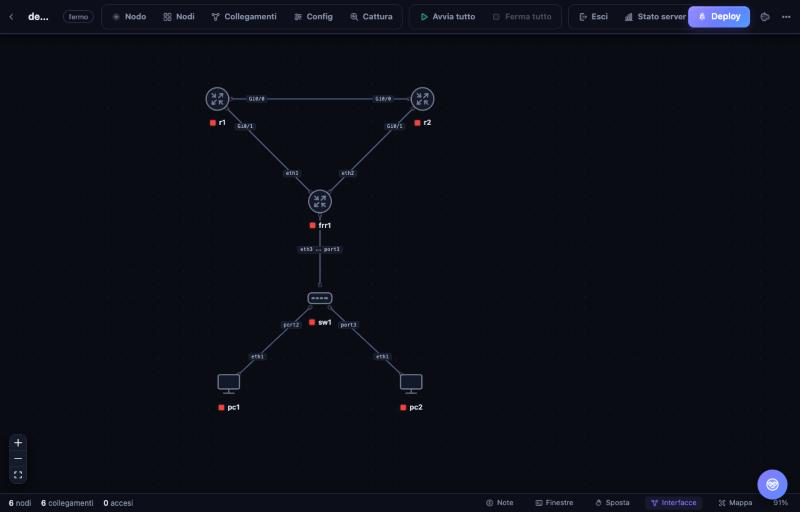

# NetSO

[](LICENSE)


Piattaforma open source per lab di rete: **VM QEMU/KVM** (Cisco, Fortinet, VyOS, Linux…) e **container Docker** (FRR, host Linux…) nello stesso lab. Puoi disegnare la topologia nel browser oppure definirla in YAML, e ogni nodo ha la sua consolle nel browser. Il tutto si controlla anche da riga di comando o via API REST.

> **EN —** Open-source all-in-one network lab platform: run **QEMU/KVM VMs** and **Docker containers** in the same topology, straight from your browser, CLI, or REST API. A self-hosted network simulation.



## Requisiti

- Server Linux bare metal: Ubuntu 22.04/24.04 o Debian 12
- CPU con VT-x/AMD-V abilitato nel BIOS (`/dev/kvm` deve esistere)
- RAM in quantità adeguata ai nodi (es. un IOSv usa 768 MB, un Cat8000v 4 GB)

## Installazione

```bash
unzip netso.zip && cd netso
sudo ./install.sh
```

Alla fine lo script stampa l'indirizzo (`http://IP-SERVER:8080`) e il **token di accesso**, che trovi anche in `/etc/netso.env`. Il servizio si chiama `netso` (`systemctl status netso`, `journalctl -u netso -f`).

## Immagini delle VM

Le immagini non sono incluse: vanno prese dal vendor con la relativa licenza (ad esempio IOSv/IOSvL2 dall'abbonamento CML, FortiGate dal portale Fortinet). Ogni immagine va in una sua cartella, con il nome usato nel template:

```
/opt/netso/images/
├── cisco-iosv/      virtioa.qcow2
├── cisco-iosvl2/    virtioa.qcow2
├── cisco-c8000v/    virtioa.qcow2
├── fortigate/       virtioa.qcow2
├── vyos/            virtioa.qcow2
└── linux-vm/        virtioa.qcow2
```

Se una cartella contiene più dischi, vengono collegati in ordine alfabetico. Ogni nodo lavora su un overlay copy-on-write: l'immagine base non viene mai toccata e "Azzera dischi" riporta il nodo allo stato di fabbrica. Le immagini Docker invece vengono scaricate da sole al primo avvio.

## Uso dal browser

1. Crea un nuovo lab e trascina i dispositivi dalla palette di sinistra.
2. Per collegare due nodi, trascina dal pallino in alto di un nodo fino all'altro: le interfacce libere vengono assegnate automaticamente, e cliccando sul collegamento puoi cambiarle.
3. Premi **Deploy** e fai doppio clic su un nodo avviato per aprirne la consolle.
4. Le VM con consolle grafica sono raggiungibili via VNC all'indirizzo mostrato nel pannello del nodo.

Scorciatoie: `Canc` elimina la selezione, `Ctrl+S` salva.

## Uso da riga di comando (lab come codice)

```bash
netso templates                    # tipi di nodo disponibili
netso images                       # immagini QEMU trovate
netso deploy /opt/netso/containers-only.yml
netso list
netso console containers-only h1   # consolle nel terminale
netso inspect containers-only      # stato, porte telnet/VNC
netso destroy containers-only      # aggiungi --delete per eliminarlo
```

Formato di un lab:

```yaml
name: ospf-mix
description: Due IOSv, un FRR e due host su uno switch
nodes:
  - {name: r1,   template: cisco-iosv}
  - {name: r2,   template: cisco-iosv, ram: 1024}   # override del template
  - {name: frr1, template: frr}
  - {name: sw1,  template: bridge}
  - {name: pc1,  template: linux-host}
  - {name: pc2,  template: linux-host}
links:
  - endpoints: [r1:Gi0/0, r2:Gi0/0]
  - endpoints: [r1:Gi0/1, frr1:eth1]
  - endpoints: [r2:Gi0/1, frr1:eth2]
  - endpoints: [frr1:eth3, sw1:port1]
  - endpoints: [pc1:eth1, sw1:port2]
  - endpoints: [pc2:eth1, sw1:port3]
```

Ogni link è un cavo punto-punto. Per mettere più nodi sullo stesso segmento si usa un nodo `bridge`, mentre per uscire sulla rete reale si usa un nodo `external` legato a un bridge già presente sull'host (es. `br0`).

### Condizionamento dei link

Ogni link può simulare una rete reale con ritardo, jitter, perdita di pacchetti e banda limitata (via `tc netem`):

```yaml
links:
  - endpoints: [r1:Gi0/0, r2:Gi0/0]
    delay_ms: 50        # latenza aggiunta per direzione (RTT ≈ 100 ms)
    jitter_ms: 10       # variazione casuale attorno al ritardo
    loss_pct: 2         # 2% di pacchetti persi
    rate_kbit: 1000     # banda massima 1 Mbit/s
```

I campi sono tutti opzionali (vuoto = cavo ideale). Dal browser si impostano nel pannello del collegamento; con il lab avviato il pulsante «Applica ora» li attiva a caldo senza riavviare i nodi.

Nei container, `eth0` è riservata alla rete di management Docker (`netso-mgmt`, con accesso a Internet) e le interfacce del lab partono da `eth1`.

## Template personalizzati

Ogni file `.yml` in `/opt/netso/templates/` aggiunge un tipo di nodo oppure sovrascrive quello integrato con lo stesso nome. Esempio:

```yaml
name: cisco-ftdv
kind: qemu
description: Cisco FTDv
icon: firewall          # router | switch | firewall | server | host | cloud
image: cisco-ftdv       # cartella in /opt/netso/images
cpus: 4
ram: 8192
nics: 6
nic_model: virtio-net-pci   # oppure e1000, vmxnet3...
disk_bus: virtio            # virtio | ide | sata
console: telnet             # telnet | vnc
iface_prefix: Gi0/
iface_start: 0
extra_args: []              # argomenti QEMU aggiuntivi
```

Per un container si usa invece `kind: docker`, indicando `image:` (immagine Docker), `cmd:` ed eventuali `env:`.

## API REST

La documentazione interattiva è su `http://IP-SERVER:8080/docs`. Le chiamate richiedono l'header `Authorization: Bearer <token>`.

| Metodo | Percorso | Funzione |
|---|---|---|
| GET | `/api/labs` | elenco dei lab |
| POST | `/api/labs` | crea un lab (`{"name":...}` oppure `{"yaml":...}`) |
| GET/PUT | `/api/labs/{lab}` e `/api/labs/{lab}/yaml` | legge o modifica la definizione |
| POST | `/api/labs/{lab}/deploy` e `/destroy` | avvia o ferma l'intero lab |
| POST | `/api/labs/{lab}/nodes/{node}/start`, `stop`, `wipe` | singolo nodo |
| WS | `/api/labs/{lab}/nodes/{node}/console?token=...` | consolle |

## Come funziona

- **Rete**: ogni collegamento è un piccolo bridge Linux. Le VM vi si attaccano tramite interfacce tap, i container tramite coppie veth spostate nel loro namespace. I bridge inoltrano anche LLDP, LACP e STP, quindi si comportano come un cavo vero.
- **VM**: `qemu-system-x86_64` con KVM, una consolle seriale su telnet (porte da 32769) e VNC (porte da 5910).
- **Stato**: `/var/lib/netso/labs/<lab>/` contiene `lab.yml`, `state.json` e gli overlay dei dischi.

## Sicurezza

NetSO gira come root, perché deve creare interfacce di rete e usare KVM e Docker. Va quindi tenuto su una rete di laboratorio fidata e il token va lasciato attivo. Per accedere da remoto è meglio passare da una VPN o da un tunnel SSH (`ssh -L 8080:localhost:8080 server`).

## Sviluppo

```bash
cd backend && python3 -m venv .venv && . .venv/bin/activate && pip install -e '.[dev]'
pytest                                                # i test girano in dry-run, senza root
NETSO_DRY_RUN=1 NETSO_HOME=/tmp/ln netso serve  # simula senza toccare l'host
cd ../frontend && npm install && npm run dev          # UI su http://localhost:5173
```

In modalità `NETSO_DRY_RUN=1` i comandi verso l'host vengono solo registrati e non eseguiti: è utile per provare la UI su qualsiasi PC.

## Contribuire

NetSO è open source e accetta volentieri contributi: vedi [CONTRIBUTING.md](CONTRIBUTING.md). La regola principale è semplice — **niente immagini, binari o licenze dei vendor nel repository**, e nessun codice copiato da altri progetti.

## Licenza

NetSO è distribuito sotto licenza **Apache-2.0**: vedi i file [LICENSE](LICENSE) e [NOTICE](NOTICE).

## Avvertenza / Disclaimer

**IT —** NetSO è un progetto indipendente e **non è affiliato né approvato** da Cisco, Juniper, Fortinet, Arista, Nokia, VyOS, GNS3, EVE-NG, PNETLab o altri vendor. Tutti i marchi appartengono ai rispettivi proprietari e sono citati solo per descrivere la compatibilità. **NetSO non include, non distribuisce e non collega nessuna immagine, firmware o licenza dei vendor**: ogni immagine va ottenuta dall'utente, che deve possederne una licenza valida. NetSO si limita a far girare le immagini che l'utente possiede già. Il software è fornito "così com'è", senza garanzie.

**EN —** NetSO is an independent project and is **not affiliated with or endorsed by** Cisco, Juniper, Fortinet, Arista, Nokia, VyOS, GNS3, EVE-NG, PNETLab, or any other vendor. All trademarks belong to their respective owners and are referenced only to describe compatibility. **NetSO does not include, distribute, or link to any vendor image, firmware, or license**: each image must be obtained by the user, who must hold a valid license for it. NetSO merely runs images the user already owns. The software is provided "as is", without warranty.
